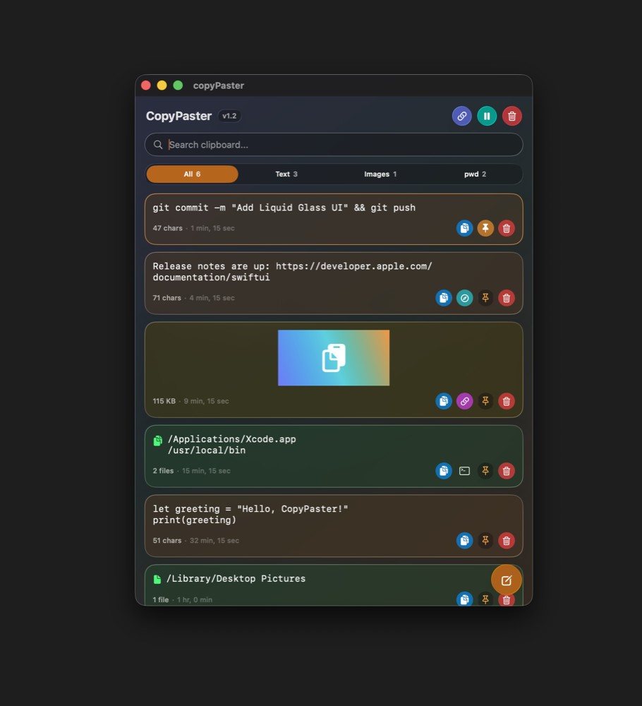

# CopyPaster

A native macOS clipboard manager with a Liquid Glass interface. CopyPaster lives in the menu bar, remembers everything you copy — text, images and file paths — and keeps it searchable across restarts.

<p align="center">
  
</p>

## Features

- **Full clipboard history** — text, images and copied files/folders, newest first, saved between launches (up to 500 items; pinned items are never trimmed).
- **Menu bar popover** — open it from the menu bar icon or with **⌘⇧V** from anywhere.
- **Search and filters** — instant search plus All / Text / Images / pwd tabs with live counts.
- **Pin favorites** — pinned items stay at the top and are never trimmed by the history limit.
- **Open links** — items containing URLs get a button (or a menu, for several links) to open them in your browser.
- **Weblinks log** — every link you copy is also recorded in `~/Documents/Weblinks.html`, newest first, with clickable links.
- **Open in Terminal** — copied files, folders or paths (e.g. `pwd` output) get a button that opens Terminal in that folder.
- **Drag images out** — drag an image tile straight into Finder, Mail, Slack or any other app.
- **Screenshots to disk** — images that only exist on the clipboard (like ⌘⌃⇧4 screenshots) are saved to a folder so you can reveal or copy their path.
- **Snippets** — type text into the compose panel to add it to your history without copying it first.
- **Pause monitoring** — stop recording temporarily while you copy something sensitive.
- **Launch at Login** — toggle it in Settings (⌘,).
- **Private by design** — no network access, no analytics; everything stays on your Mac.

## Requirements

- macOS 26.4 or later (Liquid Glass)
- Xcode 26 to build

## Build and install

```bash
git clone https://github.com/vishal781992/copyPaster.git
cd copyPaster
xcodebuild -scheme copyPaster -configuration Release -derivedDataPath build build
cp -R build/Build/Products/Release/copyPaster.app /Applications/
open /Applications/copyPaster.app
```

Or open `copyPaster.xcodeproj` in Xcode and press **⌘R**.

The global **⌘⇧V** shortcut listens for key presses in other apps, so macOS will ask you to allow CopyPaster under **System Settings → Privacy & Security → Accessibility**.

## Configuration

| What | Where |
|---|---|
| Clipboard history | `~/Library/Application Support/copyPaster/clipboard_history.json` |
| Saved clipboard images | `~/Pictures/Screenshots` by default |
| Weblinks log | `~/Documents/Weblinks.html` |

To save clipboard images somewhere else:

```bash
defaults write ~/Library/Preferences/vish.copyPaster imageSaveDirectory "/path/to/folder"
```

## Demo mode

Launch with `-demo YES` to show sample items instead of your real history. Nothing is read from or written to your history, and the clipboard isn't monitored — handy for screenshots.

```bash
open -n /Applications/copyPaster.app --args -demo YES
```

## Project layout

| File | Role |
|---|---|
| `ClipboardManager.swift` | Clipboard polling, capture, de-duplication, persistence, weblinks, Terminal |
| `ClipboardItem.swift` | Item model (text / image / file path) and link and folder detection |
| `ContentView.swift` | Header, search, filter bar, tile list, compose button |
| `ClipboardTileView.swift` | A single history tile and its actions |
| `GlassIcon.swift` | Shared Liquid Glass button and panel styles |
| `AddTextView.swift` | Compose panel for snippets |
| `AppDelegate.swift` | Menu bar item, popover, ⌘⇧V hotkey |
| `DemoData.swift` | Sample items for demo mode |

Pure SwiftUI + AppKit — no third-party dependencies.
